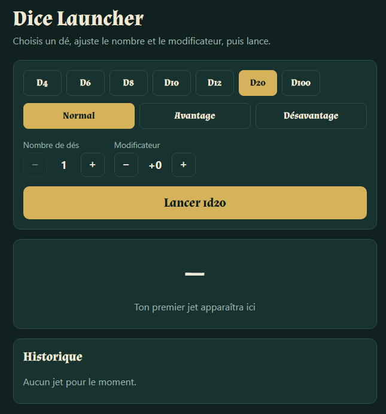

# Dice Launcher

Un lanceur de dés pour le jeu de rôle (D&D), pensé pour être utilisé à table, sur téléphone comme sur ordinateur.

**[▶ Essayer l'application](https://dice-launcher.netlify.app)**



## Fonctionnalités

- Lancer des dés **d4, d6, d8, d10, d12, d20 et d100**
- Choisir le **nombre de dés** (1 à 20) et un **modificateur** (-20 à +20)
- **Avantage / désavantage** au d20 (on garde le meilleur ou le pire de deux dés)
- Mise en évidence des **20 naturels** et des **1 naturels**
- **Historique** des 10 derniers jets, avec le détail de chaque dé
- Thème clair et sombre automatique selon les réglages du système
- Interface adaptée au mobile et accessible au clavier et aux lecteurs d'écran

## Technologies

- [React](https://react.dev/) (hooks : `useState`)
- [Vite](https://vite.dev/)
- HTML et CSS (variables CSS, thème sombre, design responsive)
- Déploiement sur [Netlify](https://www.netlify.com/)

## Lancer le projet en local

Prérequis : [Node.js](https://nodejs.org/) (version LTS récente).

```bash
git clone https://github.com/TinquenH/dice-launcher.git
cd dice-launcher
npm install
npm run dev
```

Ouvre ensuite l'adresse affichée dans le terminal (en général `http://localhost:5173`).

Pour générer la version de production :

```bash
npm run build
```

## Structure du projet

```
src/
  lib/
    dice.js      # logique de lancer des dés (indépendante de React)
  App.jsx        # interface et gestion de l'état
  main.jsx       # point d'entrée
  index.css      # styles
```

La logique de calcul est séparée de l'interface : les fonctions de `dice.js` ne dépendent pas de React, ce qui les rend simples à tester et à réutiliser.

## Idées pour la suite

- Jets enregistrés (« Attaque épée +5 », « Dégâts 1d8+3 ») avec sauvegarde dans le `localStorage`
- Saisie libre de notation (`3d8+2`)
- Animation de lancer et sons
- Application installable sur mobile (PWA)
- Salons multijoueurs en temps réel (v2 à plus long terme) : créer un salon, inviter les joueurs avec un code et partager les jets de chacun en direct. Cela nécessitera un serveur (WebSockets ou un service temps réel).

## Auteur

Quentin, développeur web et web mobile. Projet réalisé pour ma table de jeu de rôle et pour mon portfolio.

[Mon profil GitHub](https://github.com/TinquenH)
